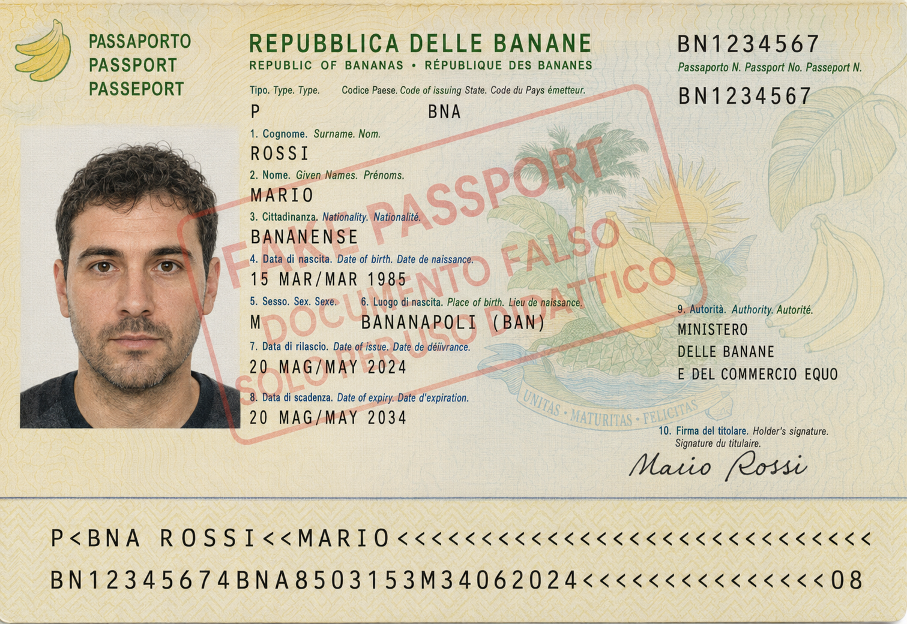
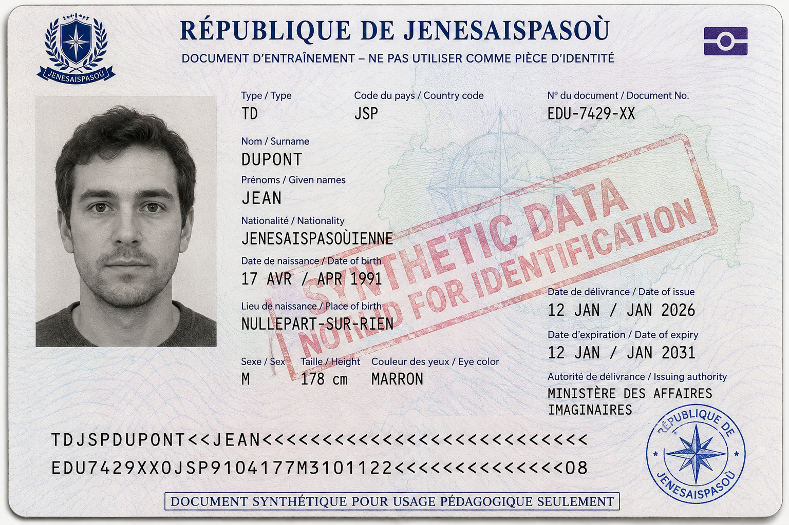
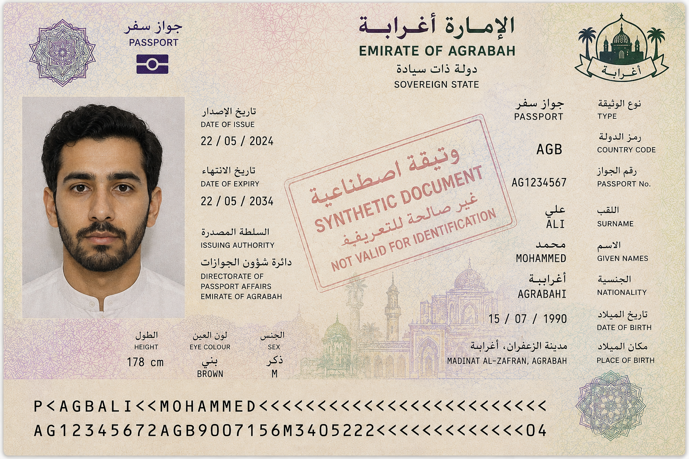

## Esempio ricorrente

### Un assistente per la commissione che valuta le domande di dottorato

- 3 candidati e altrettante domande, con _passaporto_, _certificato degli esami_ e _lettera di presentazione_ (in linguaggio naturale)

- vogliamo estrarre informazioni strutturate da questi documenti (ad es. nome, età, voti, esperienza di ricerca ecc.) per agevolare la valutazione

{}
{}

- [Certificato degli esami](../lab-snippets/data/transcript-mario-rossi.png)
- [Lettera di presentazione](../lab-snippets/data/letter-mario-rossi.txt)
    + la lettera è molto positiva
{}
{}

- [Certificato degli esami](../lab-snippets/data/transcript-jean-dupont.png)
- [Lettera di presentazione](../lab-snippets/data/letter-jean-dupont.txt)
    - la lettera contiene alcune critiche
{}
{}

- [Certificato degli esami](../lab-snippets/data/transcript-mohammed-ali.png)
- [Lettera di presentazione](../lab-snippets/data/letter-mohammed-ali.txt)
    - la lettera è positiva ma poco approfondita
{}
{}
